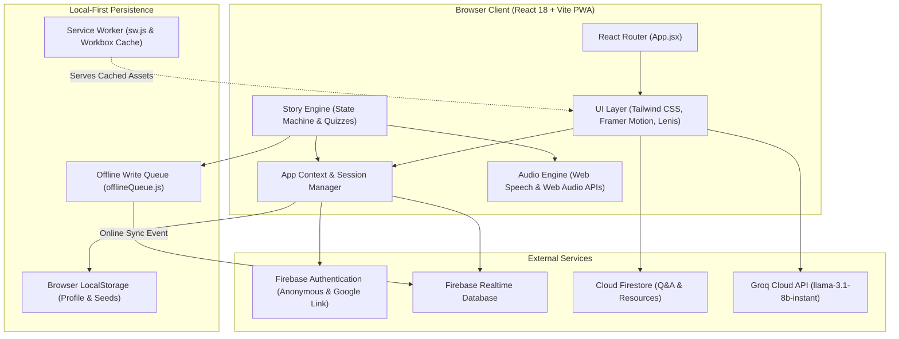

# Legalese

Constitutional literacy platform teaching Indian children legal rights through branching narrative quests, audio narration, quizzes, and offline PWA storage.

[ADD SCREENSHOT HERE]

## Problem It Solves

Many children in India lack accessible, age-appropriate awareness of their statutory protections under laws such as the Right of Children to Free and Compulsory Education Act, the Protection of Children from Sexual Offences Act, and the Child Labour Act. Legal texts are written in complex statutory terminology, and existing educational portals frequently require high-speed internet connectivity. Legalese addresses this barrier by converting constitutional rights into branching, decision-driven narrative quests that run offline on low-resource devices without collecting personal user information.

## Features

- Branching Story Engine with Recovery Arcs: Executes node-based narrative dilemmas, tracks choices, deducts hearts on risky decisions, and routes children through corrective recovery arcs rather than terminal game-overs.
  - Implemented in: [src/components/story-engine/StoryEngine.jsx](file:///c:/Users/abhig/OneDrive/Desktop/Legal/src/components/story-engine/StoryEngine.jsx) and [src/components/story-engine/StoryScreen.jsx](file:///c:/Users/abhig/OneDrive/Desktop/Legal/src/components/story-engine/StoryScreen.jsx)
- Six Constitutional Rights Narrative Modules: Six distinct story modules covering Article 21-A (Right to Education), PCMA 2006 (Protection from Child Marriage), Child Labour Act, POCSO Act 2012 (Protection from Abuse), Article 21 (Right to Healthcare), and Articles 14, 15, and 17 (Right to Equality).
  - Implemented in: [src/content/stories/junior/](file:///c:/Users/abhig/OneDrive/Desktop/Legal/src/content/stories/junior/) and [src/content/stories/senior/](file:///c:/Users/abhig/OneDrive/Desktop/Legal/src/content/stories/senior/)
- Dual Age-Tier Adaptation: Adjusts narrative scenarios, language complexity, and dilemmas between junior (ages 8 to 11) and senior (ages 12 to 16) tracks.
  - Implemented in: [src/components/onboarding/AgeTierPicker.jsx](file:///c:/Users/abhig/OneDrive/Desktop/Legal/src/components/onboarding/AgeTierPicker.jsx) and [src/lib/adaptiveDifficulty.js](file:///c:/Users/abhig/OneDrive/Desktop/Legal/src/lib/adaptiveDifficulty.js)
- Anonymous Onboarding and Pseudonymous Handles: Generates non-identifying handles (adjective-animal-number format) and customizable vector avatars with zero collection of names, phone numbers, or addresses.
  - Implemented in: [src/components/onboarding/NicknameGenerator.jsx](file:///c:/Users/abhig/OneDrive/Desktop/Legal/src/components/onboarding/NicknameGenerator.jsx), [src/components/onboarding/AvatarPicker.jsx](file:///c:/Users/abhig/OneDrive/Desktop/Legal/src/components/onboarding/AvatarPicker.jsx), and [src/components/onboarding/OnboardingScreen.jsx](file:///c:/Users/abhig/OneDrive/Desktop/Legal/src/components/onboarding/OnboardingScreen.jsx)
- Account Linking via Google Sign-In: Preserves guest progress and existing anonymous UID while linking Google authentication via a popup credential exchange.
  - Implemented in: [src/components/auth/GoogleSignIn.jsx](file:///c:/Users/abhig/OneDrive/Desktop/Legal/src/components/auth/GoogleSignIn.jsx) and [src/firebase/firebase.js](file:///c:/Users/abhig/OneDrive/Desktop/Legal/src/firebase/firebase.js)
- Hearts and Quest Progress Heads-Up Display: Tracks player stamina (3 hearts) and visualizes story progression stages across an interactive path HUD.
  - Implemented in: [src/components/story-engine/HeartsHUD.jsx](file:///c:/Users/abhig/OneDrive/Desktop/Legal/src/components/story-engine/HeartsHUD.jsx) and [src/components/story-engine/QuestPathHUD.jsx](file:///c:/Users/abhig/OneDrive/Desktop/Legal/src/components/story-engine/QuestPathHUD.jsx)
- Statutory Knowledge Check Quizzes: Evaluates player retention after each story through multiple-choice questions that reinforce legal provisions and award bonus experience points.
  - Implemented in: [src/components/story-engine/StoryEngine.jsx](file:///c:/Users/abhig/OneDrive/Desktop/Legal/src/components/story-engine/StoryEngine.jsx)
- Achievements and Milestones System: Evaluates player progress across 25 milestone criteria including story completion counts, quiz accuracy thresholds, and accumulated experience points.
  - Implemented in: [src/lib/achievements.js](file:///c:/Users/abhig/OneDrive/Desktop/Legal/src/lib/achievements.js) and [src/components/achievements/AchievementUnlock.jsx](file:///c:/Users/abhig/OneDrive/Desktop/Legal/src/components/achievements/AchievementUnlock.jsx)
- Seasonal and National Day Events: Dynamically applies experience point multipliers and visual banners on Republic Day, Children's Day, Constitution Day, and Right to Education Day.
  - Implemented in: [src/lib/seasonalEvents.js](file:///c:/Users/abhig/OneDrive/Desktop/Legal/src/lib/seasonalEvents.js)
- Speech Synthesis and Procedural Audio: Provides multilingual text-to-speech narration in English, Hindi, and Kannada via the Web Speech API and procedural audio tones via the Web Audio API without external audio files.
  - Implemented in: [src/lib/narration.js](file:///c:/Users/abhig/OneDrive/Desktop/Legal/src/lib/narration.js) and [src/lib/sound.js](file:///c:/Users/abhig/OneDrive/Desktop/Legal/src/lib/sound.js)
- Accessibility Features: Incorporates user controls for standard, large, and extra-large text scaling, high-contrast visual mode, reduced-motion preferences, and dyslexia font styling.
  - Implemented in: [src/components/story-engine/StoryEngine.jsx](file:///c:/Users/abhig/OneDrive/Desktop/Legal/src/components/story-engine/StoryEngine.jsx) and [src/App.jsx](file:///c:/Users/abhig/OneDrive/Desktop/Legal/src/App.jsx)
- Vector SVG Award Certificate: Dynamically renders and exports a downloadable and printable vector SVG certificate featuring player pseudonym, completed story badges, total experience points, and verified date.
  - Implemented in: [src/components/certificate/CompletionCertificate.jsx](file:///c:/Users/abhig/OneDrive/Desktop/Legal/src/components/certificate/CompletionCertificate.jsx)
- Educator and Facilitator Toolkit: Delivers six classroom lesson plans complete with statutory citations, guided discussion questions, curriculum alignments, and role-play activities.
  - Implemented in: [src/components/teachers/TeacherToolkit.jsx](file:///c:/Users/abhig/OneDrive/Desktop/Legal/src/components/teachers/TeacherToolkit.jsx)
- Public Reflection Feed and Moderated Legal Q&A: Enables children to post reflections and submit legal questions with client-side blocklist filtering and optional Groq AI safety moderation.
  - Implemented in: [src/components/community/CommunityWall.jsx](file:///c:/Users/abhig/OneDrive/Desktop/Legal/src/components/community/CommunityWall.jsx) and [src/lib/storageEngine.js](file:///c:/Users/abhig/OneDrive/Desktop/Legal/src/lib/storageEngine.js)
- Legal Advocate Portal: Passkey-protected dashboard allowing verified legal advocates to review student questions and publish statutory answers with optional Groq AI drafting assistance.
  - Implemented in: [src/components/advocate/AdvocateDashboard.jsx](file:///c:/Users/abhig/OneDrive/Desktop/Legal/src/components/advocate/AdvocateDashboard.jsx) and [src/lib/groqAI.js](file:///c:/Users/abhig/OneDrive/Desktop/Legal/src/lib/groqAI.js)
- Global Leaderboard and Quick-Chat Cheers: Displays top player rankings by experience points and allows players to send pre-curated, child-safe cheer messages.
  - Implemented in: [src/components/leaderboard/Leaderboard.jsx](file:///c:/Users/abhig/OneDrive/Desktop/Legal/src/components/leaderboard/Leaderboard.jsx)
- Real-Time Impact Analytics Dashboard: Aggregates real-time counts for registered users, quest completions, quiz accuracy, language distribution, and age tiers.
  - Implemented in: [src/components/impact/ImpactDashboard.jsx](file:///c:/Users/abhig/OneDrive/Desktop/Legal/src/components/impact/ImpactDashboard.jsx)
- Emergency Helpline and NGO Directory: Categorized directory of national support hotlines including Childline 1098, Police 100, Health Helpline 104, and NCPCR.
  - Implemented in: [src/components/resources/ResourceDirectory.jsx](file:///c:/Users/abhig/OneDrive/Desktop/Legal/src/components/resources/ResourceDirectory.jsx)
- Offline Write Queue: Buffers profile and quest completion writes in localStorage during network disconnection and synchronizes them to Firebase upon reconnection.
  - Implemented in: [src/lib/offlineQueue.js](file:///c:/Users/abhig/OneDrive/Desktop/Legal/src/lib/offlineQueue.js)
- Progressive Web App Service Worker: Pre-caches application assets, scripts, stylesheets, and fonts for full offline operation.
  - Implemented in: [public/sw.js](file:///c:/Users/abhig/OneDrive/Desktop/Legal/public/sw.js) and [vite.config.js](file:///c:/Users/abhig/OneDrive/Desktop/Legal/vite.config.js)

## Tech Stack

The dependencies and versions defined in [package.json](file:///c:/Users/abhig/OneDrive/Desktop/Legal/package.json) are:

### Production Dependencies
- @vercel/analytics: ^2.0.1
- canvas-confetti: ^1.9.3
- clsx: ^2.1.1
- firebase: ^10.12.2
- framer-motion: ^13.1.0
- lenis: ^1.3.26
- lucide-react: ^1.31.0
- react: ^18.3.1
- react-dom: ^18.3.1
- react-router-dom: ^6.23.1
- tailwind-merge: ^3.6.0

### Development Dependencies
- @types/react: ^18.3.3
- @types/react-dom: ^18.3.0
- @vitejs/plugin-react: ^4.3.0
- autoprefixer: ^10.4.19
- eslint: ^8.57.0
- eslint-plugin-react: ^7.34.2
- eslint-plugin-react-hooks: ^4.6.2
- eslint-plugin-react-refresh: ^0.4.7
- postcss: ^8.4.38
- tailwindcss: ^3.4.4
- vite: ^5.2.13
- vite-plugin-pwa: ^1.3.0

### Browser and External APIs
- Firebase Authentication (Anonymous and Google credential linking)
- Firebase Realtime Database (Profiles, leaderboard, cheers, and Q&A)
- Firebase Cloud Firestore (Statutory Q&A storage and resource directory)
- Groq Cloud API (llama-3.1-8b-instant model for legal answer drafting and moderation)
- Web Speech API (SpeechSynthesis)
- Web Audio API (AudioContext sound synthesizer)
- Service Worker API and Cache Storage

## Architecture Overview

The application is structured as a client-side Single Page Application (SPA) built with React 18 and Vite. State is managed centrally through React Context (`AppContext.jsx`) with localStorage synchronization. The Story Engine executes branching story graphs loaded asynchronously by age tier. Network operations follow a local-first pattern: game state updates in memory and localStorage immediately, while an offline queue (`offlineQueue.js`) manages cloud writes to Firebase Realtime Database. Realtime listeners update the leaderboard, community wall, and impact metrics.



## Prerequisites

- Node.js: version 18.0.0 or higher (verified on Node.js v24.13.0)
- npm: version 9.0.0 or higher (verified on npm v11.6.2)
- Modern web browser with SpeechSynthesis and Service Worker support (Chrome, Edge, Firefox, Safari)
- Firebase project credentials (optional for core offline gameplay, required for cloud sync and live leaderboard)
- Groq Cloud API key (optional, required only for AI drafting and AI moderation features)

## Setup and Installation

1. Clone the repository and navigate to the project directory:
```bash
git clone <repository-url>
cd Legal
```

2. Install dependencies:
```bash
npm install
```

3. Create the environment configuration file from the template:
On Linux/macOS:
```bash
cp .env.example .env
```
On Windows PowerShell:
```powershell
Copy-Item .env.example .env
```

4. Populate `.env` with your Firebase project credentials and optional Groq API key:
```env
VITE_FIREBASE_API_KEY=your-api-key-here
VITE_FIREBASE_AUTH_DOMAIN=your-project-id.firebaseapp.com
VITE_FIREBASE_PROJECT_ID=your-project-id
VITE_FIREBASE_STORAGE_BUCKET=your-project-id.appspot.com
VITE_FIREBASE_MESSAGING_SENDER_ID=123456789012
VITE_FIREBASE_APP_ID=1:123456789012:web:abcdef1234567890
VITE_FIREBASE_DATABASE_URL=https://your-project-id-default-rtdb.firebaseio.com
VITE_GROQ_API_KEY=your-groq-api-key-here
VITE_ADVOCATE_PASSKEY=your-advocate-passkey-here
```

## Environment Variables

All environment variables defined in [.env.example](file:///c:/Users/abhig/OneDrive/Desktop/Legal/.env.example):

| Variable Name | Description |
|---|---|
| `VITE_FIREBASE_API_KEY` | Client SDK API key for Firebase Authentication |
| `VITE_FIREBASE_AUTH_DOMAIN` | Firebase Auth domain used for authentication redirects |
| `VITE_FIREBASE_PROJECT_ID` | Firebase project identifier |
| `VITE_FIREBASE_STORAGE_BUCKET` | Firebase Cloud Storage bucket identifier |
| `VITE_FIREBASE_MESSAGING_SENDER_ID` | Firebase Cloud Messaging sender identifier |
| `VITE_FIREBASE_APP_ID` | Firebase web application identifier |
| `VITE_FIREBASE_DATABASE_URL` | Firebase Realtime Database URL for user and leaderboard synchronization |
| `VITE_GROQ_API_KEY` | Groq Cloud API key for legal drafting and AI moderation |
| `VITE_ADVOCATE_PASSKEY` | Passkey required to access the Legal Advocate moderation portal |

## How to Run and How to Run Tests

### Start Local Development Server
```bash
npm run dev
```
The development server will start on `http://localhost:5173`.

### Build for Production
```bash
npm run build
```
Compiles production bundles and generates PWA service worker assets in `dist/`.

### Preview Production Build
```bash
npm run preview
```
Serves the built application locally from `dist/` to verify production behavior.

### Run Narrative Graph Verification
```bash
npm run check-links
```
Executes `src/lib/linkChecker.js` to validate all decision targets, node links, and ending conditions across junior and senior story modules.

### Run Code Linter
```bash
npm run lint
```
Executes ESLint against all JavaScript and JSX source files using `.eslintrc.cjs`.

### Automated Unit and Integration Tests
There are currently no automated unit or integration tests (such as Vitest, Jest, or Playwright) configured in `package.json`. The verification script present in the repository is `npm run check-links`.

## Project Structure

```text
.
├── .eslintrc.cjs                  # ESLint code style and syntax rules
├── .firebaserc                    # Firebase project target mappings
├── .gitignore                     # Git ignore rules for dependencies and build artifacts
├── ARCHITECTURE.md                # System design and data flow documentation
├── DATA_MODEL.md                  # Database schema specifications
├── PITCH.md                       # Project summary and presentation notes
├── PRESENTATION.md                # Outline for project presentation
├── README.md                      # Project documentation
├── SCHEMA.md                      # Story node format and quiz specifications
├── SOURCES.md                     # Statutory citations and legal research sources
├── firebase.json                  # Firebase Hosting and emulator configuration
├── firestore.indexes.json         # Firestore index specifications
├── firestore.rules                # Cloud Firestore security rules
├── index.html                     # HTML root template with fonts and manifest links
├── package.json                   # Project metadata, scripts, and dependencies
├── postcss.config.js              # PostCSS configuration for Tailwind CSS
├── public/                        # Static assets served by the web server
│   ├── hero-constitution.jpg      # Landing page hero artwork
│   ├── icon.svg                   # PWA application icon
│   ├── manifest.json              # Web application manifest for PWA installation
│   └── sw.js                      # Custom service worker for offline asset caching
├── src/                           # Application source code
│   ├── App.jsx                    # Root router and route definitions
│   ├── index.css                  # Global stylesheet with Tailwind directives
│   ├── main.jsx                   # Application entry point, error boundary, and SW registration
│   ├── components/                # React component modules
│   │   ├── achievements/          # Milestone unlock popups and achievements modal
│   │   ├── advocate/              # Legal advocate answering console and passkey gate
│   │   ├── auth/                  # Google account linking component
│   │   ├── certificate/           # Vector SVG completion certificate generator
│   │   ├── community/             # Public reflection feed and moderated Q&A wall
│   │   ├── impact/                # Real-time aggregate telemetry dashboard
│   │   ├── landing/               # Landing page hero, story cards, and showcase sections
│   │   ├── leaderboard/           # Global rankings and quick-chat cheer feed
│   │   ├── not-found/             # 404 route fallback component
│   │   ├── onboarding/            # Avatar picker, handle generator, age, and language steps
│   │   ├── resources/             # Helpline directory and verified NGO listings
│   │   ├── rights-map/            # Interactive 6-stop rights trail navigator
│   │   ├── share/                 # Friend score challenge card
│   │   ├── story-engine/          # Story runner, HUDs, scene renderer, and quiz engine
│   │   ├── teachers/              # Printable classroom lesson plans and discussion guides
│   │   ├── ui/                    # Reusable visual components (buttons, canvas, particles, scroll)
│   │   └── waitlist/              # Expansion waitlist registration form
│   ├── content/                   # Multilingual text and story assets
│   │   ├── i18n/                  # UI chrome translations (en, hi, kn)
│   │   ├── scene-props/           # Parametric SVG environment illustrations
│   │   └── stories/               # Branching narrative content files
│   │       ├── junior/            # Six story modules for ages 8 to 11
│   │       └── senior/            # Six story modules for ages 12 to 16
│   ├── context/                   # Global state provider (AppContext.jsx)
│   ├── firebase/                  # Firebase SDK setup, Auth, Realtime Database, and Firestore functions
│   ├── lib/                       # Utility modules (narration, sound, achievements, queue, AI)
│   └── styles/                    # Design token definitions (tokens.css)
├── tailwind.config.js             # Tailwind CSS design system configuration
├── vercel.json                    # Single-page application rewrites for Vercel deployment
└── vite.config.js                 # Vite bundler, PWA, and manual chunk configuration
```

## Deployment

The repository contains deployment configurations for two platforms:

### Vercel
Configuration is defined in [vercel.json](file:///c:/Users/abhig/OneDrive/Desktop/Legal/vercel.json) using Single Page Application rewrites (`/index.html`).
- Build Command: `npm run build`
- Output Directory: `dist`
- Framework Preset: `Vite`

### Firebase Hosting
Configuration is defined in [firebase.json](file:///c:/Users/abhig/OneDrive/Desktop/Legal/firebase.json) with public directory `dist` and single-page rewrites to `/index.html`.
- Deploy command:
```bash
firebase deploy --only hosting
```

## Challenges and Design Decisions

1. Offline-First Resilience via Local Write Buffering:
Operating on low-resource hardware with inconsistent network access necessitated decoupling user interaction from cloud latency. The application commits quest completions and experience point updates to `AppContext` and `localStorage` immediately. If a network connection is unavailable, `src/lib/offlineQueue.js` buffers writes into an atomic queue in `localStorage`. Once the browser fires an `online` event, the queue flushes and replays mutations to Firebase Realtime Database sequentially.

2. Anonymous Session Upgrade Without Data Loss:
To eliminate barriers to entry and maintain child privacy, the platform initializes an anonymous session via `signInAnonymously`. When a child or parent chooses to authenticate with Google, creating a standard new account would orphan the accumulated progress. The implementation uses Firebase Auth's `linkWithPopup()` in `src/components/auth/GoogleSignIn.jsx`, upgrading the anonymous credential to a Google-linked account while retaining the same UID and database state.

3. Pure Vector Asset Pipeline for Bandwidth Conservation:
To ensure rapid page loads on 2G and 3G networks, the platform replaces external raster image files with parametric inline SVGs and CSS. Character avatars (`CharacterAvatar.jsx`) and environment scene objects (`props.jsx`) are rendered procedurally from coordinates and parameters. Similarly, audio narration uses the native browser SpeechSynthesis API, and sound effects use Web Audio API oscillators, eliminating external media asset downloads.

## Known Limitations and Future Improvements

- Client-Side API Key Exposure:
`src/lib/groqAI.js` accesses `import.meta.env.VITE_GROQ_API_KEY` directly from the client bundle. In production Vite builds, `VITE_*` variables are embedded into client JavaScript bundles and can be inspected by visitors. This should be moved to a backend proxy endpoint.
- Automated Test Coverage:
There are currently no automated unit or end-to-end tests (e.g., Vitest, Jest, Playwright). Only static narrative validation (`npm run check-links`) is configured.
